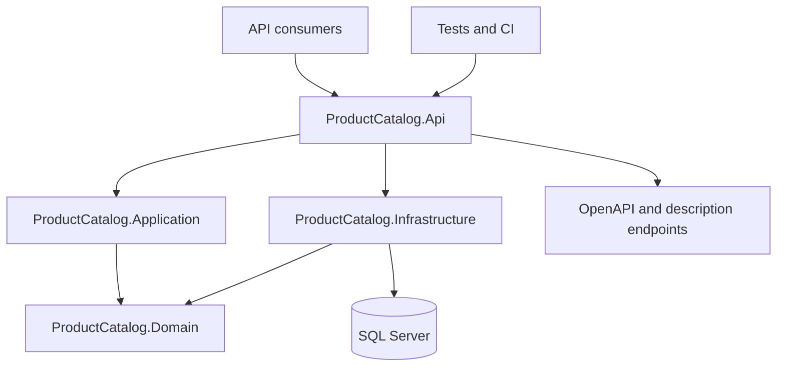

# ProductsCatalog

## Purpose

ProductsCatalog is a standalone product catalog service for an e-commerce platform. It owns product data, exposes HTTP APIs for catalog reads and writes, records MobilePhone change history, and publishes machine-readable descriptions of request flows and validation rules.

The catalog is separated from the rest of the platform because it has a distinct data model and scaling profile. Product browsing is read-heavy and can grow independently from ordering, payments, invoicing, and user management. Keeping the catalog behind its own API allows independent deployment, horizontal scaling, caching, and query optimization without coupling those decisions to transactional services.

## Engineering approach

### Design first, executable source of truth

API behavior is designed before implementation: routes, request and response models, validation rules, status codes, and acceptance scenarios are agreed first. The approved design is then expressed as executable code and tests.

The repository does not maintain a second handwritten OpenAPI file. Endpoint metadata and DTOs are the executable source used by Swashbuckle to generate OpenAPI. Reqnroll scenarios describe externally visible behavior. CI generates and validates the current OpenAPI document from the running application, so documentation cannot silently drift away from the implementation.

This combines design-first governance with code-generated artifacts:

1. define the contract and behavior;
2. implement endpoint metadata, DTOs, validation, and flow descriptors;
3. prove behavior with unit, integration, and acceptance tests;
4. derive OpenAPI, flow and validation descriptions, operation links, and
   acceptance results from those sources;
5. validate the contract and exercised HTTP responses in CI.

### Description Pattern and RAG-ready documentation

Application flows are intentionally self-describing. Flow descriptor methods use ordered `FlowStep` metadata, while validation policies expose rule descriptors and possible errors. The API makes these descriptions available through:

- `GET /products-documentation/flow`;
- `GET /products-documentation/validation-policies`.

CI derives operation-to-flow-to-policy-to-scenario links from the code and
acceptance matrix. It rejects missing or duplicate relationships, exports and
lints OpenAPI, and compares declared responses with the HTTP behavior exercised
by acceptance tests. Generated projections are ignored build artifacts, not
another specification committed to the repository. Publishing an Allure/API
portal and building RAG ingestion are later work; see [the backlog](docs/backlog.md).

## Architecture



| Layer | Responsibility |
|---|---|
| `ProductCatalog.Api` | Minimal API endpoints, HTTP contracts, exception mapping, OpenAPI, health checks, and composition root. |
| `ProductCatalog.Application` | Commands, queries, MediatR handlers, mapping, validation orchestration, logging behavior, and flow descriptions. |
| `ProductCatalog.Domain` | Aggregates, value objects, repository contracts, validation policies, rules, and domain errors. |
| `ProductCatalog.Infrastructure` | SQL Server access, EF Core command persistence, Dapper queries, migrations, repositories, and readiness checks. |

The service uses CQRS inside one deployable application. Commands work with domain aggregates and EF Core. Queries use Dapper and dedicated read models for explicit SQL and efficient projections. MediatR dispatches commands and queries without exposing infrastructure concerns to the API layer.

### Why SQL Server

The catalog is relational. Mobile phones have current and history records, and read use cases need filtering and projections. SQL Server provides transactions, indexing, and operational tooling suitable for this model.

EF Core is used where aggregate persistence and migrations matter. Dapper is used on the query side where explicit SQL and narrow result sets are more useful. See [ADR-0001](docs/adr/0001-use-sql-server.md).

## Technology stack

| Area | Technology |
|---|---|
| Runtime and API | .NET 10, ASP.NET Core Minimal APIs |
| Application flow | MediatR, CQRS |
| Domain mapping | Mapster |
| Database | SQL Server 2022 |
| Write persistence | Entity Framework Core 10 |
| Read persistence | Dapper |
| API contract | Swashbuckle OpenAPI, Redocly CLI validation |
| Logging | Serilog structured console logging |
| Unit tests | xUnit, Shouldly, Moq |
| Acceptance tests | Reqnroll, xUnit, Allure |
| Integration infrastructure | Testcontainers for SQL Server |
| Coverage | Coverlet collector, ReportGenerator |
| Containers | Docker, Docker Compose |
| CI/CD | GitHub Actions, Dependency Review, Gitleaks, Trivy |

### Repository structure

```text
src/
  ProductCatalog.Api/
  ProductCatalog.Application/
  ProductCatalog.Domain/
  ProductCatalog.Infrastructure/
tests/
  ProductCatalog.Acceptance.Tests/
  ProductCatalog.Domain.UnitTests/
  ProductsCatalog.Application.UnitTests/
  ProductsCatalog.Infrastructure.UnitTests/
  ProductsCatalog.Performance.BenchmarkTests/
docs/
  adr/
  backlog.md
  database-migrations.md
```

## Local startup

### Prerequisites

- .NET SDK `10.0.100` or a newer .NET 10 feature band (selected by `global.json`);
- Docker Engine or Docker Desktop;
- Bash, Python 3, curl, and Node.js 22 for the complete local verification command;
- Git;
- optional: `dotnet-ef` for migration commands;
- optional: Allure 2 CLI for a local acceptance report.

### Run locally

Start SQL Server:

```powershell
Copy-Item .env.example .env
# Set a strong MSSQL_SA_PASSWORD value in .env.
docker compose up -d product-db
```

Configure the API and start it:

```powershell
$env:ConnectionStrings__ProductCatalogDb = "Server=localhost,1433;Database=ProductsDb;User Id=sa;Password=<password-from-env>;TrustServerCertificate=True"
$env:Database__ApplyMigrations = "true"
dotnet run --project src/ProductCatalog.Api/ProductCatalog.Api.csproj
```

`Database__ApplyMigrations=true` is intended for local development. Hosted environments should apply migrations in a dedicated deployment step.
Repeated opt-in local starts preserve the seeded phones and their history. A failed
migration stops startup and is not retried as a whole; see
[the migration strategy](docs/database-migrations.md) for recovery and the separate
CLEAN-01 existing-data verification.

The API checks the SQL connection string and the optional `Database:ApplyMigrations`
boolean at startup. The connection string must specify `Server` and `Database`;
invalid settings stop startup with an error that does not print credentials.
Missing `Database:ApplyMigrations` means `false`. Configuration validation does
not connect to SQL Server: with migrations disabled, OpenAPI can be generated
while SQL is unavailable. `/health/ready` separately checks SQL availability
and access to the current mobile phone and history tables.

After startup, use the URLs printed by ASP.NET Core. Swagger UI is available at `/swagger`, and the OpenAPI document is available at `/swagger/v1/swagger.json`.

### Run with Docker Compose

Build the API image and start the complete local stack:

```powershell
Copy-Item .env.example .env
# Set a strong MSSQL_SA_PASSWORD value in .env.
docker build -f src/ProductCatalog.Api/Dockerfile -t productcatalogapi:latest .
docker compose up -d
```

The API is exposed at `http://localhost:5000`, and SQL Server at `localhost:1433`.

Local Compose enables `Database:ApplyMigrations` by default, matching
`appsettings.json`. The API waits for healthy SQL before applying pending
migrations at startup. Set `APPLY_MIGRATIONS=false` in `.env` to disable this;
an existing `.env` value overrides the Compose default.

`GET /mobile-phones?amount=15` includes each phone's `mainPhoto` alongside its
list fields. Filtered and by-ID lists use the same response DTO and also include
`mainPhoto`. This is the stored photo URL; access to private Blob photos is
handled separately.

Stop the containers without deleting database data:

```powershell
docker compose down
```

Remove the containers and the local SQL volume:

```powershell
docker compose down --volumes
```

### Database migrations

Install the EF Core tool if required:

```powershell
dotnet tool install --global dotnet-ef
```

Create a migration:

```powershell
dotnet ef migrations add <MigrationName> --project src/ProductCatalog.Infrastructure --startup-project src/ProductCatalog.Api
```

Apply migrations manually:

```powershell
dotnet ef database update --project src/ProductCatalog.Infrastructure --startup-project src/ProductCatalog.Api
```

Generate an idempotent deployment script:

```powershell
dotnet ef migrations script --idempotent --project src/ProductCatalog.Infrastructure --startup-project src/ProductCatalog.Api --output artifacts/migrations.sql
```

Runtime migrations are disabled by default to prevent multiple replicas from modifying the schema during scale-out. See [the migration strategy](docs/database-migrations.md) and [ADR-0004](docs/adr/0004-database-migration-strategy.md).

## API contract

Swagger UI is available at `/swagger` and the generated contract at
`/swagger/v1/swagger.json`. CI derives named operations, flow and validation
policies, HTTP statuses and scenario IDs from executable sources. For current
methods, routes, payloads and responses use the generated OpenAPI; for tested
status/cause branches use the [acceptance matrix](docs/acceptance-matrix.md).
The public [problem contract](docs/api-problem-contract.md) describes stable
error codes. No handwritten per-operation catalogue is maintained here.

The API exposes flow descriptions at `/products-documentation/flow` and domain
policy descriptions at `/products-documentation/validation-policies`. Updates
with unchanged information and deletes of already inactive phones do not add a
history entry. The `top` read means the three most recently changed active
phones, not sales or popularity. List reads return empty arrays when no active
phones match; an existing inactive phone remains readable by ID. History pages
have deterministic `ChangedAt DESC, Id DESC` ordering.

Categories and Currencies endpoints were removed. MobilePhone requests,
responses, history, and SQL tables no longer have `CategoryId`.
`Price.Currency` remains currency text in the price value object, uppercased by
`Money`; no three-letter constraint or currency lookup is enforced. Clients still sending `CategoryId` must
update their request and regenerate any client from current OpenAPI.

The EF migration `20260922220000_RemoveCatalogs` removes the old catalogue
current/history tables and `CategoryId` columns. Back up an existing database
before applying it: removed values cannot be reconstructed by rolling back.
Its behavior on a populated pre-cleanup database remains unverified under
CLEAN-01; see [migration guidance](docs/database-migrations.md).

## Health checks

| Route | Meaning |
|---|---|
| `/health/live` | The API process is running. It does not depend on SQL Server. |
| `/health/ready` | SQL Server can read the mobile phone and history tables within the five-second check timeout; otherwise `503` (plain-text health response). |

Use liveness for process restart decisions and readiness for load-balancer routing.
Readiness runs a zero-row schema probe and does not require product data. It does
not apply migrations, retry an entire startup, or change the opt-in migration policy.

Dapper catalog reads have a 12-second overall deadline and a five-second SQL command
timeout. Opening a connection is limited to three seconds per attempt and may be
retried twice for selected transient connection errors (with 0.5/1-second delays).
Once a connection is open, a failed query is never retried: callers may receive an
error even if the database later recovers. Request cancellation stops the opening,
delay or query. EF Core command writes retain their separate existing retry policy;
this read policy never repeats a write, transaction, migration or startup.

## Tests

From the repository root, run source-link and architecture checks, the complete
local build, formatting, four test suites, separate 70% coverage checks,
OpenAPI lint and Docker build with one command:

```bash
bash scripts/verify.sh
```

The script writes TRX, coverage, a combined `summary.md` and generated OpenAPI to the ignored
`artifacts/verification` directory; see [local verification](docs/local-verification.md) for the shared stage names, paths and failure rules. Infrastructure tests produce a separate HTML
and text coverage report for diagnosis without a percentage threshold; Domain
and Application retain separate 70% line-coverage gates. CI publishes the
Infrastructure report in the job summary and as an artifact. CI additionally
checks dependencies, secrets and image vulnerabilities. The Docker build stage
uses SDK 10.0.100. CI selects the SDK through `setup-dotnet` and `global.json`,
which allows newer .NET 10 feature bands.

Restore and build the solution:

```powershell
dotnet restore ProductsCatalog.sln
dotnet build ProductsCatalog.sln --configuration Release --no-restore
dotnet format ProductsCatalog.sln --verify-no-changes --no-restore
```

Run the test projects:

```powershell
dotnet test tests/ProductCatalog.Domain.UnitTests/ProductCatalog.Domain.UnitTests.csproj --configuration Release
dotnet test tests/ProductsCatalog.Application.UnitTests/ProductsCatalog.Application.UnitTests.csproj --configuration Release
dotnet test tests/ProductsCatalog.Infrastructure.UnitTests/ProductsCatalog.Infrastructure.UnitTests.csproj --configuration Release
dotnet test tests/ProductCatalog.Acceptance.Tests/ProductCatalog.Acceptance.Tests.csproj --configuration Release
```

Infrastructure and acceptance tests require Docker because SQL Server is created through Testcontainers. Acceptance tests start one SQL Server container per test run; each Reqnroll scenario gets a separate migrated database, API host, and HTTP client. The scenario hook releases the client and host and drops the database even when a scenario fails. Acceptance scenarios verify HTTP status codes, response bodies, validation details, empty collections, missing resources, and safe server-error responses.

Run benchmarks separately:

```powershell
dotnet run --configuration Release --project tests/ProductsCatalog.Performance.BenchmarkTests/ProductsCatalog.Performance.BenchmarkTests.csproj
```

Generate a local Allure report:

```powershell
npm install --global allure-commandline@2.46.1
dotnet test tests/ProductCatalog.Acceptance.Tests/ProductCatalog.Acceptance.Tests.csproj
allure generate artifacts/allure-results/acceptance -o artifacts/allure-report --clean
allure open artifacts/allure-report
```

BDD-02 adds a shared, scenario-local HTTP evidence recorder for the default,
fault and startup clients. Each exchange has paired `HTTP nnn request` and
`HTTP nnn response` JSON attachments with service/scenario identity, a stable
example instance, method/path/query, actual status/media type, body format, byte
length and unmodified text. Parsed JSON is included when valid; malformed JSON,
plain text and empty/absent bodies remain distinguishable. Transport failures
are recorded by type and rethrown. Recording sits inside the existing response
validator, so evidence survives a contract assertion failure.

The recorder queues evidence from all clients, including calls made in server
callbacks, then attaches it after the Gherkin step. Scenario IDs reuse the
acceptance matrix through Gherkin labels or an Examples `scenarioId` column;
technical cases have explicit REF identifiers. Parameters distinguish outline
examples without deriving identity from display names. Legacy per-step body
attachments remain during packages BDD-03 through BDD-06; the shared HTTP
attachments are the canonical exchange evidence. Bootstrap Swagger retrieval is
setup input, not a scenario HTTP exchange. No new dependency or runtime API
behavior is introduced. Deployment and LiveDocs promotion wait until all packages
are complete; ordinary producer CI still builds and archives its evidence.

BDD-03 makes the 15 successful catalogue cases readable as business scenarios.
Their Gherkin descriptions also populate each Allure case description.
Input and expected-result tables show exact lists, empty results, photos, prices,
explicit history pagination and the three-entry top boundary. Top is ordered by
`ChangedAt` descending, then ID descending; the normal catalogue page is ordered
by name, then ID. Update setup separates the original entry from its replacement.
Create follows its actual Location, and create/update/delete check SQL current
state and ordered history, attaching the observed state before assertions.
Success GET and DELETE calls use the recorder's faithful bodyless request evidence.
The acceptance matrix retains the same stable IDs after title changes. Validation,
races/faults, technical cases and deeper contract checks remain in their later
packages; no application endpoint or database schema changes in this package.

BDD-04 makes the 23 validation, missing-resource and framework rejection cases
explicit. Nine framework failures are individual scenarios with HTTP input tables,
raw body text or a single JSON-member mutation. Type/null cases start from an
otherwise valid create body; the missing-member case omits only commonDescription.
Every revised case checks the problem status, media type, stable code, path,
trace ID and error/missing-member arrays alongside its cause-specific expectations.
A SQL snapshot before the rejected action is compared with current data and history
afterward, including field values as well as counts; the report records the result.
The original stable scenario IDs are retained. Converting the nine framework
examples to plain scenarios replaces their example instance identities because
the Case/Status/Code outline parameters are no longer their input model. Malformed
text and bodyless requests retain faithful HTTP evidence. Runtime API behavior,
validation policies and schemas are unchanged; deployment and LiveDocs promotion
remain deferred. Races/persistence faults, technical scenarios and deeper contract
validation remain in BDD-05 through BDD-08.

BDD-05 makes 16 conditional-write and repository-failure cases explicit. The
seven write-race/no-op scenarios show the original profile, competing action,
pending request, expected status and ordered history. Their timeline is buffered
inside the server callback and attached from the calling scenario. Complete SQL
snapshots before and after the pending result prove that the losing/no-op request
preserves every saved field, including ChangedAt and history identities; the
original inserted snapshot is also preserved. Physical removal is recorded as a
SQL action, while competing update/delete requests retain their HTTP evidence.

The three injected SaveChanges failures and six read-repository failures reuse
the full-value unchanged-state comparison from BDD-04. Reports record actual
repository calls and safe problem responses. Save failures are injected before
EF SaveChanges, so these cases verify that queued changes remain unsaved; they
do not simulate a database failure during a transaction. The history read-failure
case explicitly fails at its initial GetById lookup before loading history.
Stable scenario/example identities remain unchanged. Application behavior,
contracts, schema and dependencies are unchanged; deployment and LiveDocs promotion
remain deferred. Health/startup/documentation cases continue in BDD-06.

BDD-06 completes the 10 technical cases: health/readiness, repeated startup,
documentation and acceptance isolation. Probe tables assert exact status, text
media type and Healthy/Unhealthy body; unhealthy readiness is a documented 503
text exception to business problem JSON. SQL observations distinguish deletion
of the scenario database from a missing history table and its migration recovery.
Unqueried table/seed state is recorded as null instead of an invented empty result.

Startup records the requested override, effective ApplyMigrations value, actual
probe and full current/history snapshots with applied/pending migration IDs. The
repository appsettings.json currently enables migrations; an absent setting still
defaults to false in configuration validation. A repeated enabled startup preserves
all stored values and migration IDs. Evidence excludes connection strings.
Documentation tables list the nine flow and five policy names; responses also
contain nonempty steps/rules/errors. Publishing policy metadata does not prove
runtime enforcement. Descriptor failures check the complete safe problem and
actual call count. Isolation examples record separate database identities and
verify one correctly linked marker phone/history without relying on run order.
Stable scenario/example identities remain unchanged. Runtime API/configuration,
schema, dependencies and CI are unchanged; deployment and LiveDocs promotion
remain deferred. Request/response contracts and semantic flow/RAG links follow
in BDD-07 and BDD-08, then BDD-09 audits the complete selected evidence.

BDD-07 checks the generated request and response contracts for every scenario
client, including fault and race clients. The checker covers the schema vocabulary
emitted here: objects/arrays, required members, nullability, scalar types, numeric
enums, reference/composition schemas, patterns, numeric widths and applicable
formats. It validates query/path parameters, JSON bodies, statuses/media and the
required create `Location` header, including its relationship to the returned ID.
Regression tests corrupt real generated-schema samples to ensure these failures
are detected; they also check field documentation and example/schema agreement.
This is a checker for this producer's emitted OpenAPI 3.0 vocabulary, not a general
JSON Schema implementation. New formats require explicit support; excessive
recursive depth fails instead of silently skipping children.

The API's Swagger filters add field semantics and typed examples to the DTO-derived
schemas. Response fields that are always serialized are marked present; request
requiredness still follows serializer metadata. In particular, an unannotated
nested record parameter is not automatically a required JSON member. Unknown
request members remain allowed, matching System.Text.Json. Request JSON member
matching is case-insensitive like ASP.NET's web serializer, so a known member
such as `Brand` still receives the `brand` schema checks; response names remain
exact. Captured request bytes are never renamed or rewritten. The nullable brand
filter documents case-insensitive names and numeric enum values. Photo references
can be filenames or URLs, so they do not claim an absolute-URI format. Existing SQL
history timestamps omit the offset: OpenAPI now calls that form `date-time-local`
and explains the stored UTC semantics, rather than claiming RFC 3339 `date-time`.
The stricter checks also exposed a missing SQL projection: top phones returned a
null description despite the non-null DTO. The query now selects the stored
description, and SQL/HTTP tests check it against the created phone. Business
validation and write/history behavior are unchanged; no dependency is added.

Each captured exchange has a linked `HTTP contract observation` with its operation,
request-schema result and actual response-contract result. Invalid requests still
reach the API and retain their exact bytes. Schema-invalid input is permitted in
400/415 rejection scenarios, while the returned problem must satisfy its schema;
a schema-valid request can still fail a business rule. Routing 404/405 and media
415 use the shared problem schema. Health probes have an explicit text contract
and report schema comparison as not applicable. Bootstrap Swagger retrieval stays
outside scenario exchanges. Deployment and LiveDocs promotion remain deferred;
BDD-08 covers semantic flow/rule/evidence links before the BDD-09 final audit.

BDD-08 gives all 57 flow steps readable source descriptions and stable keys.
Source attributes identify nine flows, five policies, ten policy rules, the inline
empty-ID guard and declared branch conditions/effects. The existing generated
operation-links artifact now includes that catalogue, source locations, explicit
scenario/branch/rule joins and uncovered branches/rules. Runtime flow and policy
endpoint shapes are retained; their text/inventories are compared with source.

Each exchange receives `HTTP documentation links` joined to its actual request,
response and contract observation by exchangeId. A target operation/status in the
When phase identifies the primary scenario exchange unless explicitly marked
supporting (the first DELETE in the repeated-delete action); setup/competing calls and
follow-up reads do not claim its branch. Expected rejection rules must be present
in actual validation errors. Declared steps/policies and expected branches are
source knowledge, not runtime step telemetry. Technical framework labels have
explicit source branches; health/startup/isolation evidence does not invent
business-rule execution. Scenario IDs, example identities and existing tables
are preserved.

The hardware policy remains standalone and the phone policy has no money rules.
BDD-09 closes the incoming-update/later-history-query gaps and gives all active
published rule IDs real rejection evidence. It adds 12 BDD examples for the missing
blank strings, price boundaries and later read failure. The defensive null-list
branch remains explicitly classified: the real repository returns a non-null
list, including an empty list, and no normal HTTP 404 is invented for it.
The [source documentation contract](docs/source-description-contract.md) explains
these limits and same-bundle retrieval joins. No new Python script, package, Azure
resource, business rule or RAG index is added. Final selected-snapshot evidence
and the LiveDocs refresh are recorded in the BDD-09 audit handoff; generated
sources do not establish historical design-first approval.

Generated `.feature.cs` files are build artifacts and must not be edited manually.

## CI

The workflow calls `scripts/ci.sh` for source checks, audited restore and
build, formatting, each test suite and coverage, and the generated OpenAPI
contract. `scripts/verify.sh` uses the same entry points locally. GitHub
Actions owns job dependencies, artifact upload, secrets and image scanning.

GitHub Actions runs for pull requests and pushes to `master`:

1. restore, Release build, and format verification;
2. check acceptance/source/architecture links, start the API, generate OpenAPI,
   and validate it with a pinned Redocly CLI and runtime acceptance assertions;
3. run Domain, Application, Infrastructure, and acceptance tests;
4. enforce separate 70% line-coverage gates for Domain and Application; report
   Infrastructure coverage without a percentage gate;
5. run Dependency Review on pull requests and Gitleaks secret scanning;
6. build the container and fail on high or critical Trivy findings;
7. after scanning, tag and publish the same local image as commit-SHA and `latest`
   to Docker Hub on `master`, verifying matching image IDs and registry digests.

The image build depends on a quality gate that requires successful build/OpenAPI, tests with separate 70% Domain/Application coverage, secret scanning, and Dependency Review on pull requests. On a push, Dependency Review is expected to be skipped. The build, Trivy scan and conditional Docker Hub publication run in the same job, without rebuilding. A failed required check or high/critical container vulnerability blocks publication. Test result artifacts are uploaded even when a test fails.

NuGet audit is enabled for all restores through `Directory.Build.props`. Automatic Dependency Submission maintains the dependency graph. Dependabot remains intentionally disabled.

See [ADR-0010](docs/adr/0010-portable-ci-core.md) for the shared script
boundary and [ADR-0009](docs/adr/0009-image-publication-boundary.md) for image
publication.

## Operations

The API is stateless; durable state stays in SQL Server. Multiple API replicas can therefore serve catalog reads behind a load balancer. Read-heavy endpoints can be scaled independently from other e-commerce services, while Dapper queries, SQL indexes, and future caching can be optimized without changing the order or payment domains.

Database migrations are executed once before rollout rather than by every replica. Readiness prevents traffic from reaching an instance when SQL Server is unavailable, while liveness remains independent of external dependencies.

## Architecture decisions

The [ADR index](docs/adr/README.md) covers SQL/CQRS, contracts, migration,
source documentation, errors, acceptance isolation, concurrency and image
publication. It distinguishes decisions implemented now from later hosting
and retrieval work.

Current work and intentional exclusions are recorded in [the repository backlog](docs/backlog.md).

### LiveDocs publication (LD/5)

CI exports OpenAPI, flows, validation policies and operation/scenario links and
preserves the acceptance run's raw Allure output. A commit-pinned reusable workflow
from ECommerceStore.LiveDocs packages those inputs with feature files and source
commit/run identity. Bundle validation is a required quality-gate check before
building/scanning/publishing the service image. PRs retain a short-lived
`documentation-bundle` artifact for review and never upload to Azure.

After every successful master image publication, the archive job writes the
same source's bundle and discovery receipt to the private `livedocs` Blob container.
The consolidated store uses `stecproductsdevmb261013` by default. Products authenticates
with a container-scoped SAS held in its Actions secret `LIVEDOCS_STORAGE_SAS_TOKEN`.
The token needs read/create/write access to `livedocs`; read permits byte verification
when retrying an upload. It grants no access to `photos` or `invoices`. No Azure login,
new identity or Terraform resource is needed for this producer step.

Configure the SAS secret before a master push. Missing credentials, expiry, upload
failures or conflicting existing bytes fail the
archive job. PRs never upload. Docker Hub publication remains subject to all existing
gates and uses the already scanned image. Bundle validation remains mandatory.
The previous `LIVEDOCS_PUBLISH_ENABLED` variable is no longer used; a successful master
run publishes automatically, without an additional activation setting.

The job writes a content-addressed bundle first, then the discovery receipt:

```text
livedocs/reports/products/<source-commit>/<bundle-sha256>.zip
livedocs/candidates/v1/products/<workflow-run-id>-<bundle-sha256>.json
```

The ZIP contains raw Allure results and attachments, Reqnroll feature sources, generated
OpenAPI, flows, validation policies and operation/scenario links. Products generates
these inputs from its tested commit; LiveDocs generates the Allure HTML when building
its documentation image. The receipt records the source commit/run, checksum, size
and a stable private Blob URL without a SAS query. The `documentation-reference`
Actions artifact and archive job summary expose the paths for the next integration
step. A retry accepts an existing object only after downloading and comparing its
bytes; it never overwrites a different bundle or receipt.

### Configure the Products archive upload

Run the following in PowerShell from the consolidated Terraform folder after the
`livedocs` container has been applied. Azure CLI must be signed into the subscription;
GitHub CLI must be signed into an account that can manage this repository's Actions
secrets and variables. The existing storage account allows Shared Key access. This
creates an HTTPS-only container SAS with a 90-day expiry, captures it locally and
sends it to GitHub through standard input without printing it:

```powershell
$archiveAccount = terraform output -raw livedocs_storage_account_name
if ($LASTEXITCODE -ne 0) { throw 'Storage account output failed' }
$expiry = (Get-Date).ToUniversalTime().AddDays(90).ToString('yyyy-MM-ddTHH:mmZ')
$archiveSas = az storage container generate-sas --account-name $archiveAccount --name livedocs --permissions rcw --https-only --expiry $expiry --output tsv --only-show-errors
if ($LASTEXITCODE -ne 0 -or [string]::IsNullOrWhiteSpace($archiveSas)) { throw 'SAS creation failed' }
$archiveSas | gh secret set LIVEDOCS_STORAGE_SAS_TOKEN --repo MichalBoczula/ProductsCatalog
if ($LASTEXITCODE -ne 0) { throw 'GitHub secret update failed' }
Remove-Variable archiveSas
gh variable set LIVEDOCS_STORAGE_ACCOUNT --body $archiveAccount --repo MichalBoczula/ProductsCatalog
if ($LASTEXITCODE -ne 0) { throw 'GitHub account variable update failed' }
```

`LIVEDOCS_VERSION` is optional and defaults to `v1`. Renew the SAS before its expiry by
replacing the same Actions secret. Do not paste the token into chat, source files or
workflow output. For UI setup, use Products → Settings → Secrets and variables →
Actions; create the secret above and, if overriding the default account, the nonsecret
`LIVEDOCS_STORAGE_ACCOUNT` variable.
See the official [Azure container SAS command](https://learn.microsoft.com/en-us/cli/azure/storage/container#az-storage-container-generate-sas)
and [GitHub secret command](https://cli.github.com/manual/gh_secret_set).

Configure the secret before the next normal master push. Check that
`archive-documentation` actually succeeds. It is skipped on PRs and when its required
quality/image jobs do not succeed. Download the `documentation-reference`
artifact for the exact archive URL.
From the signed-in Azure CLI, this lists uploaded Products bundles without exposing
the CI SAS:

```powershell
az storage blob list --account-name $archiveAccount --container-name livedocs --prefix reports/products/ --query '[].{name:name,size:properties.contentLength}' --output table
```

If an enabled upload fails, fix the credential or access issue and rerun only the
failed archive job. It reuses the same tested bundle and verifies existing bytes.
Generating a second bundle for the same run can create ambiguous receipts, so avoid
rerunning successful packaging jobs during archive recovery.

LiveDocs independently verifies a completed successful producer CI run and opens
a manifest PR in its own repository. Its image builder generates Allure 2.46.1,
then the consolidated ECommerceStore.Terraform deploys the chosen documentation image digest. This
handoff is asynchronous: service and documentation publication are not an atomic
deployment transaction. See [ADR-0011](docs/adr/0011-livedocs-blob-publication.md)
and [ADR-0012](docs/adr/0012-consolidated-livedocs-upload.md) for this producer's
authentication and storage setup. LiveDocs' current reader/import documentation still
describes the older OIDC setup; configuring its reader and adding the Products path
are a separate follow-up. This change does not update a running documentation site.

